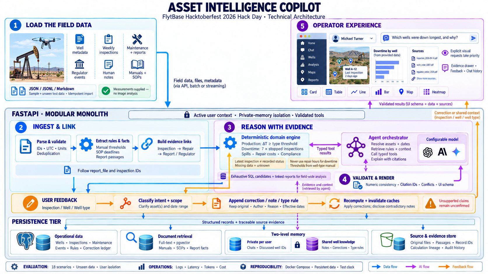

# FieldSense

Evidence-backed **Asset Intelligence Copilot** for oil-well operations — plain-English Q&A with inline visuals, shared knowledge, private memory, and formal corrections.

**Repository:** [github.com/roktopus/FieldSense](https://github.com/roktopus/FieldSense/)

Built for [FlytBase Hacktoberfest 2026](https://github.com/FlytBaseAILabs/flytbase-ahc-swe-asset-intelligence-dataset) (Apache-2.0).

| | |
|---|---|
| **GitHub** | https://github.com/roktopus/FieldSense/ |
| **UI** | http://localhost:5173 |
| **API docs** | http://localhost:8000/docs |
| **License** | [Apache-2.0](./LICENSE) |

---

## Architecture

Modular monolith: React SPA → FastAPI → PostgreSQL 16 (pgvector + FTS), with a background worker for async jobs. Deterministic domain tools own the numbers; an optional LLM plans, explains, and picks visuals.



*Source diagram from the official challenge dataset; vendored at [`docs/assets/architecture.png`](./docs/assets/architecture.png).*

More detail: [`docs/ARCHITECTURE.md`](./docs/ARCHITECTURE.md) · decisions in [`docs/decisions/`](./docs/decisions/).

---

## Features

- **Production & downtime** — ΔT thresholds (T200 / T350), inspection-based downtime math
- **Spills & compliance** — effective volumes, reportable thresholds, containment checks
- **Generative UI** — status cards, tables, charts, maps bound to server result rows
- **Evidence drawer** — claims cite resolvable inspection / maintenance / note IDs
- **Shared vs private memory** — demo-user scoped chats; shared notes visible across users
- **Corrections** — formal overrides preserve originals; analytics use the effective layer
- **Works without an LLM** — intent router answers the analytical challenge queries offline

---

## Prerequisites

- [Docker](https://docs.docker.com/get-docker/) and Docker Compose
- Challenge **sample-data** directory from the dataset repo (mounted read-only)

```bash
git clone https://github.com/FlytBaseAILabs/flytbase-ahc-swe-asset-intelligence-dataset.git
```

Do **not** load evaluation expected answers into the runtime retrieval index or production prompts.

---

## Quick start

```bash
# 1. Configure dataset mount
cp .env.example .env
# Set DATASET_HOST_PATH to your local sample-data directory, e.g.
# DATASET_HOST_PATH=/absolute/path/to/.../sample-data

# 2. Start stack (db, api, worker, web)
make up

# 3. Import sample (idempotent)
make import-data

# 4. Open the UI
open http://localhost:5173   # or visit the URL in a browser
```

| Service | Port |
|---|---|
| Web | `5173` |
| API | `8000` |
| Postgres | `5432` |

Stop with `make down`. Logs: `make logs`.

### Demo walkthrough

1. Select a demo user (e.g. **Michael Turner**) — this is identity selection, not production auth.
2. Ask: *Which wells in Northeast Block 7 had the most downtime between 16 June and 16 October 2026, and why? Show a bar chart.*
3. Open **View evidence** on the answer.
4. Ask: *Is WELL-0001 producing oil right now? Show me its status card.*
5. Ask: *Which wells in Northeast Block 8 are not producing oil right now, and why? Show them in a table.*
6. Switch users — private conversations reset; shared notes remain.

---

## Repository layout

```text
FieldSense/
├── backend/             # FastAPI, domain, analytics, ingestion, tests
├── frontend/            # Vite + React + Tailwind SPA
├── docs/                # Architecture, ADRs
├── docker-compose.yml
├── Makefile
└── .env.example
```

---

## Configuration

Copy [`.env.example`](./.env.example) → `.env`. Important variables:

| Variable | Purpose |
|---|---|
| `DATASET_HOST_PATH` | Host path to `sample-data` (Compose bind mount) |
| `APP_ENV` | `development` \| `staging` \| `production` |
| `EVALUATION_AS_OF` | Analysis clock (default `2026-10-17T00:00:00Z`) |
| `MODEL_PROVIDER` / `MODEL_BASE_URL` / `MODEL_API_KEY` / `MODEL_NAME` | Optional OpenAI-compatible LLM |
| `CORS_ORIGINS` | Allowed browser origins (never `*` in production) |
| `SESSION_SECRET` | Session cookie signing (≥ 24 random chars in production) |
| `POSTGRES_*` | Database credentials used by Compose |

Analytics paths must work when the model provider is unavailable (degraded / router-only mode).

Never commit `.env` or API keys.

### Production checklist

- Set `APP_ENV=production` and a strong `SESSION_SECRET`.
- Restrict `CORS_ORIGINS` to your real web origin(s).
- Change `POSTGRES_PASSWORD` (and rotate any demo defaults).
- Prefer terminating TLS at a reverse proxy; Compose binds Postgres to `127.0.0.1` only.
- Demo user picker (`X-User-Id`) is **not** production authentication — disable or replace before a real deployment.
- OpenAPI `/docs` is disabled when `APP_ENV=production`.

---

## Development

### Tests

```bash
# Domain unit tests (host)
cd backend && python3 -m venv .venv && .venv/bin/pip install -e ".[dev]"
.venv/bin/pytest tests/domain -q

# Domain + evaluation against imported DB (container)
make evaluate
# or: docker compose exec api pytest tests/domain tests/evaluation -q
```

### Re-import

```bash
make import-data
# or explicitly:
docker compose exec api python -m app.ingestion.cli run \
  --path /data/sample-data --dataset-version sample-v1
```

### Demo identity

The UI user picker sets a demo identity. The API trusts `X-User-Id` for the challenge and enforces private-memory scoping in the backend.

---

## Design principles

1. **Source authority** — Numbers from deterministic tools/SQL; the model plans and explains.
2. **Immutable sources** — Dataset mounted read-only; imports are idempotent with content hashes.
3. **Discover, don’t hardcode** — Well counts, areas, and types come from import.
4. **Evidence always** — Factual claims cite resolvable record IDs.
5. **Memory isolation** — Private chats filtered by demo user before retrieval.
6. **Honest conflicts** — Informal notes never silently override measurements.
7. **Eval hygiene** — Official Q&A fixtures stay in the test harness, not the knowledge base.

See also [`docs/KNOWN_LIMITATIONS.md`](./docs/KNOWN_LIMITATIONS.md).

---

## Challenge materials

Official problem statement, dataset guide, screens, and evaluation queries:

[FlytBaseAILabs/flytbase-ahc-swe-asset-intelligence-dataset](https://github.com/FlytBaseAILabs/flytbase-ahc-swe-asset-intelligence-dataset)

Read in order: `01-problem-statement.md` → `02-dataset-guide.md` → `03-evaluation-queries.md` (fixtures only) → `04-prerequisites.md`.

---

## Documentation

| Doc | Purpose |
|---|---|
| [`docs/ARCHITECTURE.md`](./docs/ARCHITECTURE.md) | System design |
| [`docs/KNOWN_LIMITATIONS.md`](./docs/KNOWN_LIMITATIONS.md) | Honest gaps |
| [`docs/decisions/`](./docs/decisions/) | ADRs |

---

## License

Apache License 2.0 — see [`LICENSE`](./LICENSE).

## Disclaimer

Sample manuals and SOPs are fictional challenge materials, not real operating or legal guidance. Inspection image files are not supplied; volume estimates in the dataset are already derived. Confirm dataset redistribution terms before vendoring sample data into a public remote.
