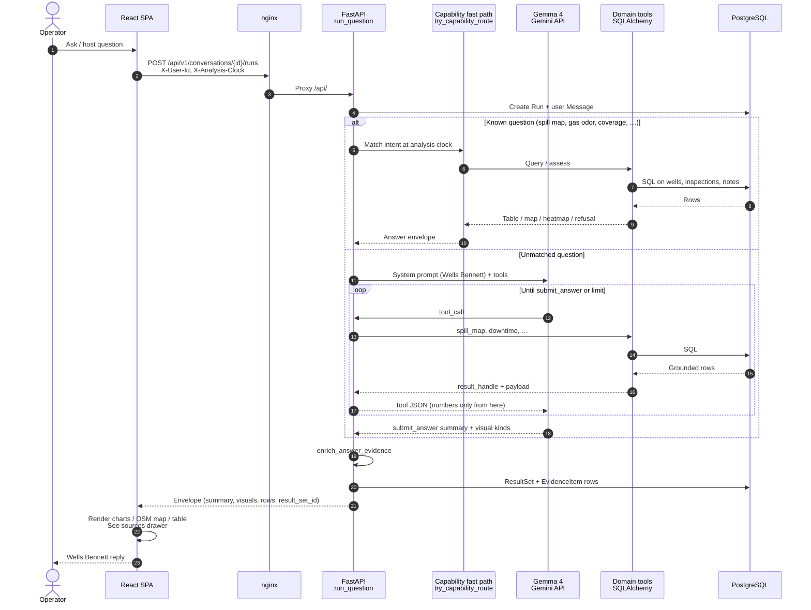

# FieldSense

Evidence-backed **Asset Intelligence Copilot** for oil-well operations — plain-English Q&A with inline visuals, shared knowledge, private memory, and formal corrections.

**Repository:** [github.com/roktopus/FieldSense](https://github.com/roktopus/FieldSense/)

Built for [FlytBase Hacktoberfest 2026](https://github.com/FlytBaseAILabs/flytbase-ahc-swe-asset-intelligence-dataset) (Apache-2.0).

| | |
|---|---|
| **GitHub** | https://github.com/roktopus/FieldSense/ |
| **UI** | http://localhost:5173 |
| **API docs** | http://localhost:8000/docs |
| **License** | [Apache-2.0](./LICENSE) |

---

## Tech stack

 Python 3.12 API,  React 18 SPA,  PostgreSQL 16. Gemma (`gemma-4-26b-a4b-it`) on the  Gemini API is the answer model.  Docker Compose runs the web, API, worker, and database containers.

Icons are from [Simple Icons](https://simpleicons.org/). Libraries without a published mark are listed as text only.

| Category | Libraries | Where they are used |
|---|---|---|
| Interface |  React 18,  TypeScript,  Tailwind CSS | The single-screen shell: Wells Bennett’s thread, the ask box, the lease plat, and the Questions toolbar |
| Charts | Recharts | Answer visuals chosen from the row shape: bar, line, area, pie, scatter, and treemap |
| Maps |  Leaflet, React Leaflet,  OpenStreetMap | Spill maps and coordinate pins |
| 3D |  Three.js | Wells Bennett’s animated hard-hat mark on the home screen and on each reply |
| Web delivery |  Vite,  nginx | Vite builds the SPA. nginx serves it on port 5173 and proxies `/api/` to the API |
| API |  FastAPI, Uvicorn,  Pydantic | HTTP routes, request bodies, and settings loaded from the environment |
| Model |  google-genai (Gemini API) | Wells Bennett’s tool-calling loop. HTTPX is only the optional OpenAI-compatible provider |
| Data |  SQLAlchemy 2, psycopg,  PostgreSQL 16 (pgvector image) | Wells, inspections, notes, corrections, conversations, and the background job table |
| Tests |  pytest, PyYAML | Domain and scenario tests. PyYAML loads the final-question harness files |

---

## Architecture

Modular monolith: React SPA → FastAPI → PostgreSQL 16 (pgvector + FTS), with a background worker for async jobs. Gemma on the Gemini API plans tool calls, explains, and picks visuals. Deterministic domain tools own the numbers. Set `ANSWER_MODE=router` to use the offline phrase router instead.


*Source diagram from the official challenge dataset; vendored at [`docs/assets/architecture.png`](./docs/assets/architecture.png).*

### How an answer is generated

Product path is `ANSWER_MODE=llm` (default). The operator asks Wells Bennett; the API either returns a known capability answer immediately or runs Gemma in a tool loop. Numbers come from SQL tools, not from the model inventing figures.



Optional offline path: when `ANSWER_MODE=router`, `run_question` skips Gemma and uses the phrase router (`_route`), which still calls the same capability tools and SQL. Evaluation harnesses set that mode so scores stay deterministic.

Current behavior: [`docs/PRODUCT.md`](./docs/PRODUCT.md).

---

## Features

- **Production & downtime** — ΔT thresholds (T200 / T350), inspection-based downtime math
- **Spills & compliance** — effective volumes, reportable thresholds, containment checks
- **Generative UI** — status cards, tables, charts, maps bound to server result rows
- **Evidence drawer** — claims cite resolvable inspection / maintenance / note IDs
- **Shared vs private memory** — demo-user scoped chats; shared notes visible across users
- **Corrections** — formal overrides preserve originals; analytics use the effective layer
- **Model answers** — the copilot calls your model; figures still come from tools. `ANSWER_MODE=router` is the optional offline path

---

## Prerequisites

- [Docker](https://docs.docker.com/get-docker/) and Docker Compose
- Challenge **sample-data** directory from the dataset repo (mounted read-only)

```bash
git clone https://github.com/FlytBaseAILabs/flytbase-ahc-swe-asset-intelligence-dataset.git
```

Do **not** load evaluation expected answers into the runtime retrieval index or production prompts.

---

## Quick start

```bash
# 1. Configure dataset mount
cp .env.example .env
# Set DATASET_HOST_PATH to your local sample-data directory, e.g.
# DATASET_HOST_PATH=/absolute/path/to/.../sample-data

# 2. Start stack (db, api, worker, web)
make up

# 3. Import sample (idempotent)
make import-data

# 4. Open the UI
open http://localhost:5173   # or visit the URL in a browser
```

| Service | Port |
|---|---|
| Web | `5173` |
| API | `8000` |
| Postgres | `5432` |

Stop with `make down`. Logs: `make logs`.

### Demo walkthrough

1. Choose **Who’s asking** — demo identity only, not production sign-in. **Wells Bennett** is the analyst in the thread. Host questions live in the **Questions** toolbar, not on the opening screen.
2. Ask: *Which wells in Northeast Block 7 had the most downtime between 16 June and 16 October 2026, and why? Show a bar chart.*
3. Open **View evidence** on the answer.
4. Ask: *Is WELL-0001 producing oil right now? Show me its status card.*
5. Ask: *Which wells in Northeast Block 8 are not producing oil right now, and why? Show them in a table.*
6. Switch users — private conversations reset; shared notes remain.

---

## Repository layout

```text
FieldSense/
├── backend/             # FastAPI, domain, analytics, ingestion, tests
├── frontend/            # Vite + React + Tailwind SPA
├── docs/                # docs/PRODUCT.md
├── docker-compose.yml
├── Makefile
└── .env.example
```

---

## Configuration

Copy [`.env.example`](./.env.example) → `.env`. Important variables:

| Variable | Purpose |
|---|---|
| `DATASET_HOST_PATH` | Host path to `sample-data` or `test-data/dataset` (Compose bind mount) |
| `DATASET_PROFILE` | `sample` \| `test` (Makefile + harness gating) |
| `APP_ENV` | `development` \| `staging` \| `production` |
| `EVALUATION_AS_OF` | Analysis clock (`2026-10-16` sample / `2027-01-15` test) |
| `ANSWER_MODE` | `llm` (default) or `router` (optional offline phrase router) |
| `MODEL_PROVIDER` / `MODEL_NAME` / `GEMINI_API_KEY` | Gemma on the Gemini API (`google`, `gemma-4-26b-a4b-it`). Key from [AI Studio](https://aistudio.google.com/apikey) |
| `MODEL_BASE_URL` / `MODEL_API_KEY` | Only when `MODEL_PROVIDER=openai_compatible` |
| `CORS_ORIGINS` | Allowed browser origins (never `*` in production) |
| `SESSION_SECRET` | Session cookie signing (≥ 24 random chars in production) |
| `POSTGRES_*` | Database credentials used by Compose |

`ANSWER_MODE=llm` with `MODEL_PROVIDER=google` will not answer until `GEMINI_API_KEY` and `MODEL_NAME` are set. It does not silently switch to the phrase router.

Never commit `.env` or API keys.

### Production checklist

- Set `APP_ENV=production` and a strong `SESSION_SECRET`.
- Restrict `CORS_ORIGINS` to your real web origin(s).
- Change `POSTGRES_PASSWORD` (and rotate any demo defaults).
- Prefer terminating TLS at a reverse proxy; Compose binds Postgres to `127.0.0.1` only.
- Demo user picker (`X-User-Id`) is **not** production authentication — disable or replace before a real deployment.
- OpenAPI `/docs` is disabled when `APP_ENV=production`.

---

## Development

### Tests

```bash
# Domain unit tests (host)
cd backend && python3 -m venv .venv && .venv/bin/pip install -e ".[dev]"
.venv/bin/pytest tests/domain -q

# Sample Q1–Q18 (requires sample-data import)
make DATASET_PROFILE=sample evaluate

# Final-question YAML harness (requires test-data import)
make DATASET_PROFILE=test up
make DATASET_PROFILE=test import-data
make harness-final
```

### Re-import

```bash
make DATASET_PROFILE=sample import-data   # or DATASET_PROFILE=test
# Container path is always /data/sample-data (bind mount from DATASET_HOST_PATH)
```

### Demo identity

The UI user picker sets a demo identity. The API trusts `X-User-Id` for the challenge and enforces private-memory scoping in the backend.

---

## Design principles

1. **Source authority** — The model plans and explains. Numbers come from deterministic tools/SQL.
2. **Immutable sources** — Dataset mounted read-only; imports are idempotent with content hashes.
3. **Discover, don’t hardcode** — Well counts, areas, and types come from import.
4. **Evidence always** — Factual claims cite resolvable record IDs.
5. **Memory isolation** — Private chats filtered by demo user before retrieval.
6. **Honest conflicts** — Informal notes never silently override measurements.
7. **Eval hygiene** — Official Q&A fixtures stay in the test harness, not the knowledge base.

Limits and how answers are produced: [`docs/PRODUCT.md`](./docs/PRODUCT.md).

---

## Challenge materials

Official problem statement, dataset guide, screens, and evaluation queries:

[FlytBaseAILabs/flytbase-ahc-swe-asset-intelligence-dataset](https://github.com/FlytBaseAILabs/flytbase-ahc-swe-asset-intelligence-dataset)

Read in order: `01-problem-statement.md` → `02-dataset-guide.md` → `03-evaluation-queries.md` (fixtures only) → `04-prerequisites.md`.

---

## Documentation

[`docs/PRODUCT.md`](./docs/PRODUCT.md) — who Wells Bennett is, how an answer is made, and the limits that are still true.

---

## License

Apache License 2.0 — see [`LICENSE`](./LICENSE).

## Disclaimer

Sample manuals and SOPs are fictional challenge materials, not real operating or legal guidance. Inspection image files are not supplied; volume estimates in the dataset are already derived. Confirm dataset redistribution terms before vendoring sample data into a public remote.
